# 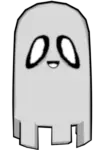  MADRUGANDO... 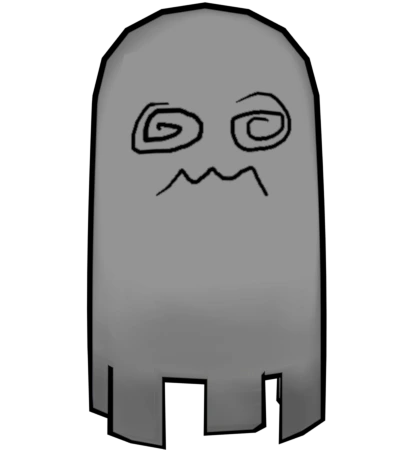

<p align="center">
  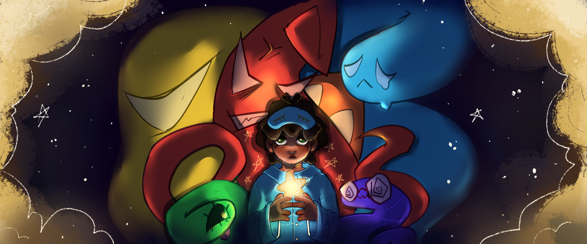
</p>

<p align="center">
  <b>Estudar <s>NÃO</s> precisa ser assustador!</b>
</p>


## 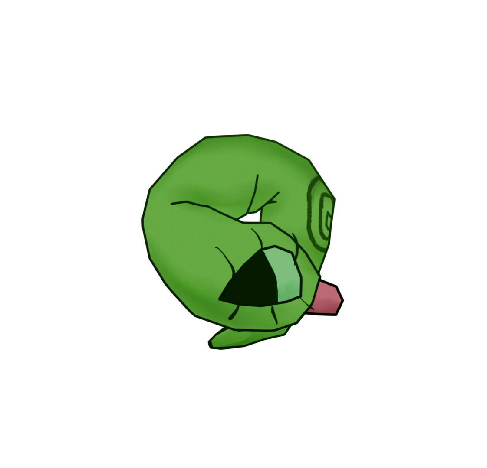  SOBRE O PROJETO:

O Madrugando é um projeto de TCC que propõe o desenvolvimento de um jogo web educacional. O jogo busca unir aprendizado e gamificação de forma divertida e engajadora, estimulando desenvolver habilidades como digitação, atenção, agilidade e precisão nos jogadores.


## 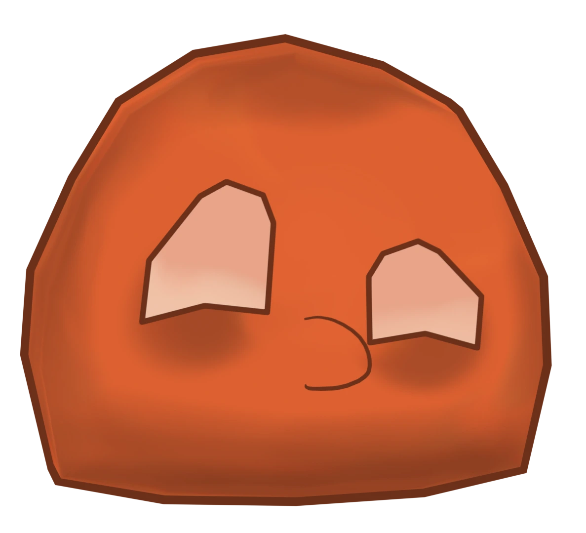 FUNCIONALIDADES:

- Landing Page tematizada;
- Jogo web com foco em digitação e questionários;
- Customização de partidas.


## 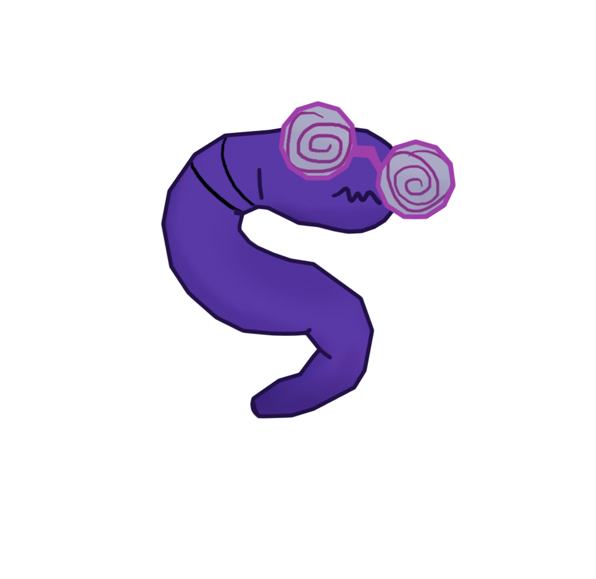 TECNOLOGIAS UTILIZADAS:

<p> 
    
    
    
    
</p>

## 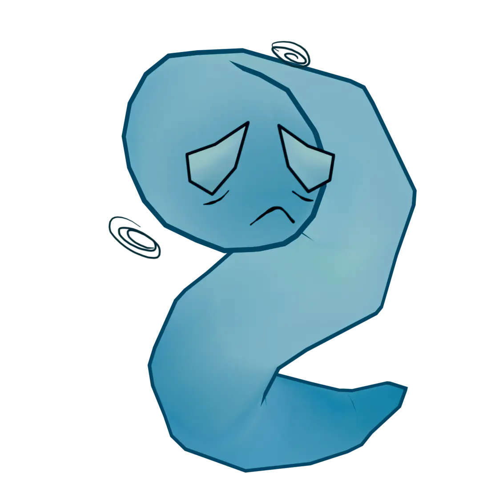 ESTRUTURA DO PROJETO:

````md id="g4x1nr"
📁assets   # Imagens, áudios e elementos gráficos

📁pages    # Páginas HTML

📁scripts  # Scripts de funcionalidades do jogo e site

📁styles   # Estilo CSS

── index.html  # Página principal

── README.md   
````

##  DOCUMENTAÇÃO:
Além do código-fonte, o projeto possui documentos complementares que apresentam os aspectos acadêmicos, técnicos e de desenvolvimento do Madrugando:
- Artigo do TCC:
- Game Design Document (GDD):
- Documento de Requisitos: 


## 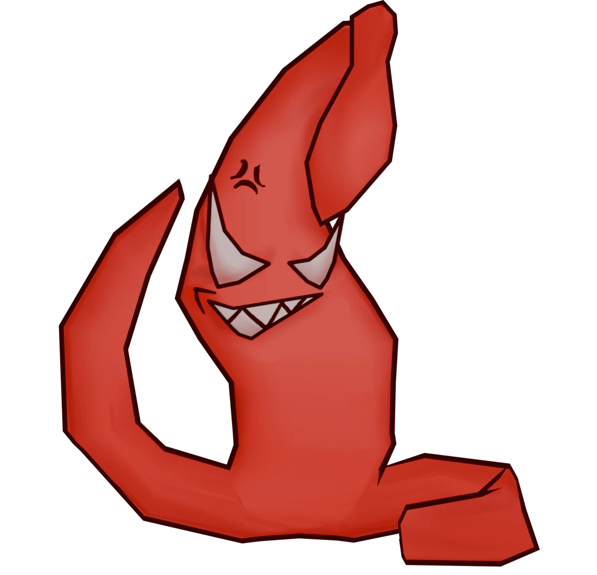 AMBIENTE DE DESENVOLVIMENTO:

- Clone o repositório: git clone https://github.com/Madrugando-Team/Madrugando.git
- Acesse a pasta: cd Madrugando
- Abra o arquivo Index.html ou utilize o Live Server no VS Code.


## 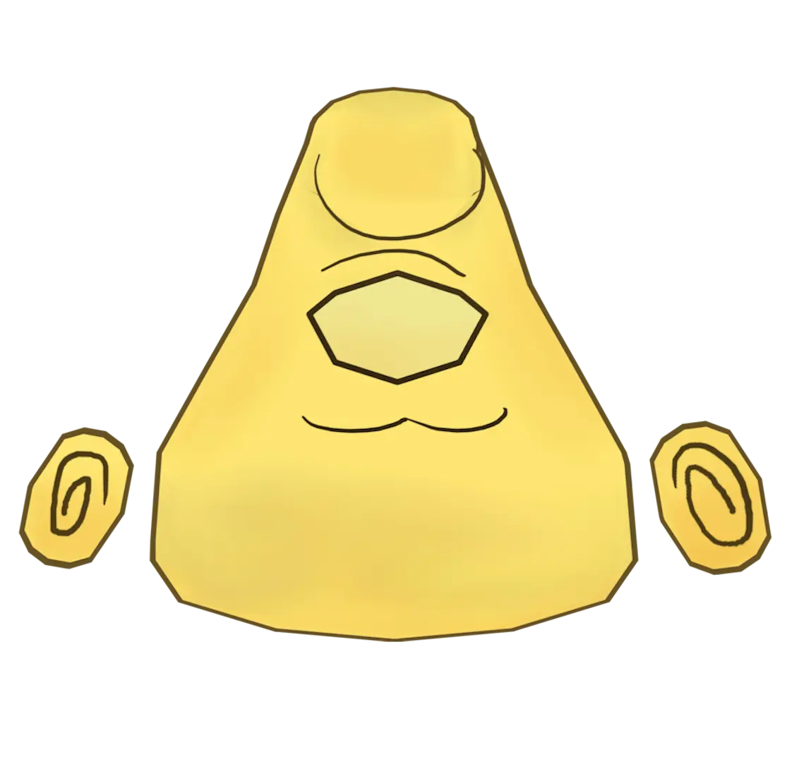 Preview:
<p align="center">
  <b>Imagem de Partida</b>
</p>
<p align="center">
  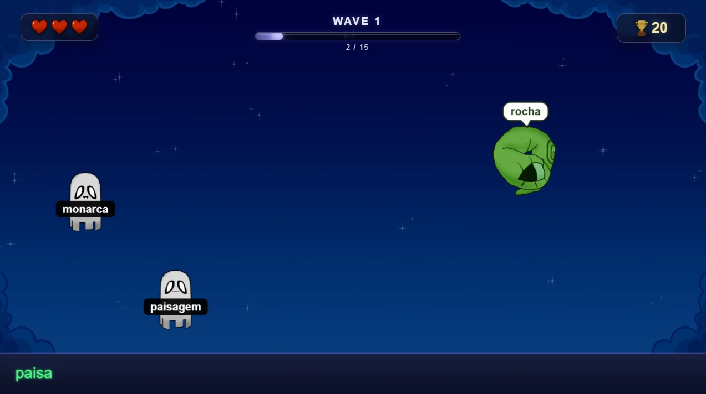
</p>

<p align="center">
  <b>Questionário</b>
</p>
<p align="center">
  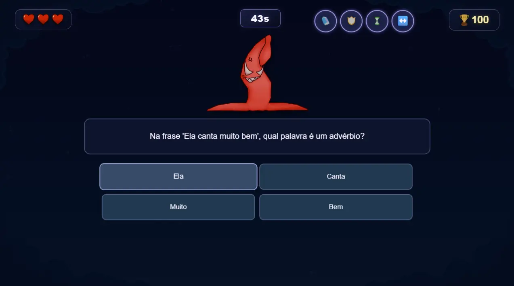
</p>


##  Colaboradores:


<table align="center">
  <tr>
    <td align="center"> 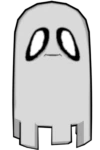 </td>
    <td align="center">
      <a href="https://github.com/xxxRafaelxxx" target="_blank"> 
        <br />
        <sub><b>Rafael Santos da Silva</b></sub></a>
    </td>
    <td align="center">
      <a href="https://github.com/RicardoPCP" target="_blank"> 
        <br />
        <sub><b>Ricardo Pessoa Campos Pereira</b></sub></a>
    </td>
    <td align="center">
      <a href="https://github.com/Viniverasss" target="_blank"> 
        <br />
        <sub><b>Vinicius Xavier Veras</b></sub></a>
    </td>
     <td align="center">  </td>
